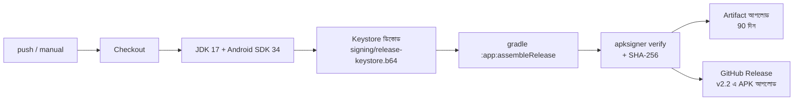

<div align="center">


# YT Downloader — APK

**YouTube / Facebook ভিডিও ডাউনলোডার · Kotlin + Jetpack Compose · yt-dlp ইঞ্জিন**

[](https://github.com/HasibApps/apk-06/actions/workflows/build.yml)
[](https://github.com/HasibApps/apk-06/releases/latest)
[](https://github.com/HasibApps/apk-06/releases)
[](#-apk-ডিটেইলস)
[-orange)](#-apk-ডিটেইলস)

### [⬇️ APK ডাউনলোড করুন](https://github.com/HasibApps/apk-06/releases/download/v2.2/YTDownloader-v2.2-arm64-v8a-release.apk)

<a href="https://github.com/HasibApps/apk-06/releases/latest"><b>সব রিলিজ দেখুন →</b></a> · <a href="https://github.com/HasibApps/apk-06/releases/download/v2.2/SHA256SUMS.txt">SHA256SUMS.txt</a>

</div>

---

## 📲 APK ডিটেইলস

| | |
|---|---|
| **অ্যাপের নাম** | YT Downloader |
| **ভার্সন** | **2.2** (versionCode `4`) |
| **প্যাকেজ** | `com.example.ytdl` |
| **ফাইল** | [`YTDownloader-v2.2-arm64-v8a-release.apk`](https://github.com/HasibApps/apk-06/releases/download/v2.2/YTDownloader-v2.2-arm64-v8a-release.apk) |
| **সাইজ** | **38.9 MiB** (40,769,717 bytes ≈ 40.8 MB) — yt-dlp + ffmpeg বাইনারি সহ |
| **আর্কিটেকচার** | `arm64-v8a` (64-bit) — **v2.2.1 এ `armeabi-v7a` সাপোর্ট চাইলে বলুন** |
| **Android** | `minSdk 24` (Android 7.0) → `targetSdk 34` (Android 14) |
| **বিল্ড টাইপ** | `release` (signed) — R8/minify বন্ধ, তাই yt-dlp/ffmpeg নেটিভ লাইব্রেরি অক্ষত |
| **সাইনিং স্কিম** | APK Signature Scheme **v2 + v3** (RSA-2048 / SHA256withRSA) |
| **সার্টিফিকেট SHA-256** | `25:E6:80:70:4B:DB:C5:62:B5:FC:51:80:87:36:94:BB:14:83:48:3C:60:83:DF:34:79:13:39:72:BA:71:88:67` |
| **APK SHA-256** | `b21bc9818cc846bbe867870d442f82470f07dc7b10d791964ce2a13cb1e08c9b` |
| **বিল্ড** | GitHub Actions **#4** · commit [`c0d8fa0`](https://github.com/HasibApps/apk-06/commit/c0d8fa0) · 14 Nov 2026, 08:59 UTC |

<details>
<summary><b>🔍 SHA-256 যাচাই করবেন যেভাবে</b></summary>

```bash
# Linux / macOS / Termux
sha256sum YTDownloader-v2.2-arm64-v8a-release.apk
# → b21bc9818cc846bbe867870d442f82470f07dc7b10d791964ce2a13cb1e08c9b

# Windows PowerShell
Get-FileHash YTDownloader-v2.2-arm64-v8a-release.apk -Algorithm SHA256
```

> ⚠️ প্রতিবার নতুন বিল্ড হলে APK এর SHA-256 বদলায় (Gradle টাইমস্ট্যাম্পের কারণে)।
> সবসময় [সর্বশেষ রিলিজের](https://github.com/HasibApps/apk-06/releases/latest) `SHA256SUMS.txt` এর সাথে মিলিয়ে নিন।
> **সার্টিফিকেটের fingerprint কিন্তু কখনও বদলায় না** — সেটাই "একই সাইনিং" এর প্রমাণ।

</details>

---

## 🔐 সাইনিং (সব বিল্ডে একই সার্টিফিকেট)

এই রিপোতে **`signing/release-keystore.b64`** নামে release keystore টি ভার্সন কন্ট্রোলড,
তাই GitHub Actions বিল্ড আর আপনার লোকাল বিল্ড — **সব APK একই সার্টিফিকেটে সাইন** হয়।
ফলে নতুন ভার্সন পুরোনো ইনস্টলের **উপরেই আপডেট** হয় (আনইনস্টল করতে হয় না)।

| Field | Value |
|---|---|
| Key algorithm | `RSA 2048` |
| Signature algorithm | `SHA256withRSA` |
| Keystore type | `JKS` |
| Alias | `ytdownloader` |
| Subject (DN) | `CN=Hasib Apps, OU=Android, O=HasibApps, L=Dhaka, ST=Dhaka, C=BD` |
| Validity | 14 Nov 2026 → 01 Apr 2054 |
| **SHA-256** | `25:E6:80:70:4B:DB:C5:62:B5:FC:51:80:87:36:94:BB:14:83:48:3C:60:83:DF:34:79:13:39:72:BA:71:88:67` |
| **SHA-1** | `2D:EE:51:C4:2A:26:A0:AA:AD:DC:35:D5:E3:20:75:EC:B5:BD:C7:F9` |

```bash
# APK এর সিগনেচার যাচাই
apksigner verify --print-certs YTDownloader-v2.2-arm64-v8a-release.apk
# অথবা
keytool -printcert -jarfile YTDownloader-v2.2-arm64-v8a-release.apk
```

> 🔒 চাইলে keystore টি রিপো থেকে সরিয়ে **GitHub Secret** বানাতে পারেন —
> `KEYSTORE_BASE64`, `KEYSTORE_PASSWORD`, `KEY_ALIAS`, `KEY_PASSWORD`।
> Workflow আগে secret দেখে, না পেলে `signing/release-keystore.b64` ব্যবহার করে।
> বিস্তারিত: [`signing/README.md`](signing/README.md)।
>
> ❗ **নতুন keystore বানাবেন না** — নতুন কী = পুরোনো অ্যাপের উপর আপডেট ইনস্টল হবে না
> (`App not installed` এরর)।

---

## ✨ ফিচার

<table>
<tr><td width="50%" valign="top">

**⬇️ ডাউনলোড**
- ভিডিও লিংক পেস্ট করে MP4 / MP3 / M4A ডাউনলোড
- কোয়ালিটি: 360p / 480p / 720p / 1080p / অডিও only
- Active Queue — pause, resume, retry, cancel, progress, speed, ETA
- History — search, play, share, delete, swipe-to-delete
- একসাথে সর্বোচ্চ **৫টি** ডাউনলোড
- Foreground Service + WakeLock → অ্যাপ বন্ধ করলেও ডাউনলোড চলে

</td><td width="50%" valign="top">

**🍪 Facebook সাপোর্ট**
- Private ভিডিওর জন্য in-app login (WebView) দিয়ে cookie সেভ
- `cookies.txt` import / paste সাপোর্ট
- yt-dlp auto-retry + engine self-update
- Android **Share** মেনু → bottom-sheet popup (অ্যাপ না খুলেই ডাউনলোড)

</td></tr>
<tr><td valign="top">

**⚙️ সেটিংস**
- Engine mode: **Native (yt-dlp)** / **Flask API** / Hybrid
- yt-dlp engine update (এক ক্লিকে)
- Default format, concurrent downloads (1–5), Wi-Fi only
- Embed thumbnail / metadata, subtitles
- Foreground notification এ প্রতি ডাউনলোডের % ও MB/s
- ৪টি থিম (Light / Dark / AMOLED / System)

</td><td valign="top">

**🧰 টেক স্ট্যাক**
- Kotlin 1.9.24 · Jetpack Compose (Material 3, BOM 2024.06.00)
- `io.github.junkfood02.youtubedl-android:library` **0.17.2** + `ffmpeg`
- DataStore Preferences · Coil · Activity Compose
- AGP 8.5.0 · Gradle 8.7 · JDK 17
- `compileSdk 34` · `minSdk 24`

</td></tr>
</table>

---

## 📥 ইনস্টল

1. উপরের **⬇️ APK ডাউনলোড করুন** বাটনে চাপ দিন (সরাসরি লিংক:
   [`YTDownloader-v2.2-arm64-v8a-release.apk`](https://github.com/HasibApps/apk-06/releases/download/v2.2/YTDownloader-v2.2-arm64-v8a-release.apk))।
2. ফোনের Settings → **Install unknown apps / Unknown sources** এ ব্রাউজার বা ফাইল ম্যানেজারকে অনুমতি দিন।
3. APK টি খুলে **Install** চাপুন।
4. অ্যাপ চালু করে প্রযোজ্য অনুমতি দিন:
   - **Notifications** (ডাউনলোড প্রোগ্রেস দেখতে)
   - **Ignore battery optimization / Unrestricted** (ব্যাকগ্রাউন্ড ডাউনলোডের জন্য — Xiaomi/Oppo/Vivo তে জরুরি)

> ℹ️ আগের কোনো **debug-সাইনড** বিল্ড ইনস্টল থাকলে একবার আনইনস্টল করতে হবে (সিগনেচার আলাদা ছিল)।
> এরপর থেকে সব রিলিজ **একই কী** দিয়ে সাইন হবে — আপডেট সোজা ইনস্টল হবে।
>
> Play Protect সতর্কতা দেখালে **Install anyway** চাপুন — APK টি স্ব-স্বাক্ষরিত।

---

## 🤖 GitHub Actions দিয়ে বিল্ড (CI)

`.github/workflows/build.yml` — প্রতি `push` এ এবং **Actions → Build & Release APK → Run workflow** চাপলেই চলে।



**Workflow যা যা করে:**

| Step | কাজ |
|---|---|
| Set up JDK 17 | Temurin 17 (AGP 8.5 এর জন্য বাধ্যতামূলক) |
| Set up Android SDK | `platforms;android-34`, `build-tools;34.0.0` ইনস্টল + license accept |
| Prepare signing keystore | Secret `KEYSTORE_BASE64` **অথবা** রিপোর `signing/release-keystore.b64` ডিকোড করে `$RUNNER_TEMP` এ রাখে |
| Build | `gradle :app:assembleRelease` (signed) |
| Verify | `apksigner verify --verbose --print-certs` — সিগনেচার না মিললে বিল্ড ফেল |
| Artifact | `YTDownloader-v2.2-release-apk` (Actions রানে ডাউনলোডযোগ্য) |
| Release | ট্যাগ `v2.2` এ APK + `SHA256SUMS.txt` আপলোড, নোটে ভার্সন/সাইজ/সার্টিফিকেট fingerprint |

**কোথায় দেখব:** [Actions রান](https://github.com/HasibApps/apk-06/actions) · [শেষ সফল বিল্ড](https://github.com/HasibApps/apk-06/actions/runs/43578172463) · [রিলিজ](https://github.com/HasibApps/apk-06/releases/tag/v2.2)

### লোকাল বিল্ড (Termux / Linux) — একই সাইনিং সহ

```bash
pkg install openjdk-17 gradle            # Termux (একবারই)
bash signing/setup-local-signing.sh      # keystore ডিকোড → keystore.properties
gradle assembleRelease                   # → app/build/outputs/apk/release/app-release.apk
```

শুধু টেস্ট করতে চাইলে: `bash build.sh` → `app-debug.apk` (release key দিয়ে সাইন হয় না)।

### নতুন ভার্সন রিলিজ করবেন যেভাবে

```bash
# 1) app/build.gradle.kts এ versionCode 4 → 5, versionName "2.2" → "2.3"
# 2) commit + push
git commit -am "release: v2.3" && git push
```

Workflow নিজেই `v2.3` ট্যাগে নতুন release বানাবে — **একই সার্টিফিকেটে সাইন হয়ে**।
(চাইলে নিজে ট্যাগ দিতে পারেন: `git tag v2.3 && git push origin v2.3`)

---

## 🗂️ প্রজেক্ট স্ট্রাকচার

```
.
├── app/
│   ├── build.gradle.kts              # applicationId, signingConfigs, ভার্সন
│   ├── proguard-rules.pro
│   └── src/main/
│       ├── AndroidManifest.xml       # permissions, activities, DownloadService
│       ├── java/com/example/ytdl/
│       │   ├── MainActivity.kt       # Scaffold + নেভিগেশন + ডাউনলোড/হিস্টরি/সেটিংস UI
│       │   ├── DM.kt                 # DownloadManager — yt-dlp engine, queue, notifications
│       │   ├── DownloadService.kt    # Foreground service (ব্যাকগ্রাউন্ড ডাউনলোড)
│       │   ├── Cookies.kt            # cookie capture / parse / store
│       │   ├── CookieLoginActivity.kt# in-app Facebook login
│       │   ├── ShareActivity.kt      # Android Share → bottom-sheet
│       │   ├── Data.kt / Ui.kt       # ডেটা মডেল, থিম, shared UI
│       │   ├── CrashActivity.kt      # ক্র্যাশ রিপোর্টার
│       │   └── App.kt
│       └── res/                      # adaptive icon, logo, theme, colors
├── signing/
│   ├── release-keystore.b64          # 🔐 সব বিল্ডে একই সাইনিং কী
│   ├── setup-local-signing.sh        # লোকাল বিল্ডের জন্য keystore ডিকোড
│   └── README.md                     # সাইনিং ডকুমেন্টেশন
├── .github/workflows/build.yml       # CI: signed APK → artifact → GitHub Release
├── build.gradle.kts / settings.gradle.kts / gradle.properties
├── build.sh                          # Termux debug বিল্ড হেল্পার
├── README_BN.md                      # ফিচার/ব্যবহারের বিস্তারিত নোট (বাংলা)
└── archive/YTDownloader_v4.zip       # মূল সোর্স আর্কাইভ (যেভাবে এসেছে)
```

---

## 🔑 পারমিশন

| Permission | কেন দরকার |
|---|---|
| `INTERNET`, `ACCESS_NETWORK_STATE` | ভিডিও তথ্য / ডাউনলোড, Wi-Fi-only চেক |
| `FOREGROUND_SERVICE`, `FOREGROUND_SERVICE_DATA_SYNC` | অ্যাপ বন্ধ করলেও ডাউনলোড চালু রাখতে |
| `POST_NOTIFICATIONS` | ডাউনলোড প্রোগ্রেস নোটিফিকেশন (Android 13+) |
| `WAKE_LOCK` | স্ক্রিন বন্ধ হলে ডাউনলোড না থামাতে |
| `REQUEST_IGNORE_BATTERY_OPTIMIZATIONS` | OEM ব্যাটারি কিলার এড়াতে (ঐচ্ছিক) |
| `WRITE_EXTERNAL_STORAGE` | শুধু Android 9 (API 28) বা তার নিচে Downloads ফোল্ডারে লেখার জন্য |

Cookies শুধু ফোনের private storage এ (DataStore) থাকে — কোনো সার্ভারে যায় না।

---

## 🩺 ট্রাবলশুটিং

| সমস্যা | সমাধান |
|---|---|
| `App not installed` | আগের debug-সাইনড অ্যাপ আনইনস্টল করুন; স্টোরেজে জায়গা দেখুন |
| YouTube/Facebook হঠাৎ কাজ করে না | **Settings → Update yt-dlp Engine** চাপুন |
| Facebook private ভিডিও | **Settings → 🍪 Add / Manage Cookies** → Login with Facebook → Save |
| ব্যাকগ্রাউন্ডে ডাউনলোড থেমে যায় | Settings → *Allow background downloads* → battery = **Unrestricted** |
| "This app isn't compatible" | ডিভাইসটি `arm64-v8a` কিনা দেখুন (প্রায় সব আধুনিক ফোনে আছে) |
| Play Protect ব্লক করছে | *Install anyway* — অ্যাপ Play Store এ নেই |

---

## ⚖️ ডিসক্লেইমার

- এই অ্যাপটি **শিক্ষামূলক / ব্যক্তিগত ব্যবহারের** জন্য। ডাউনলোড করা কনটেন্টের কপিরাইট
  সম্পূর্ণ ব্যবহারকারীর দায়িত্ব — নিজের বা অনুমতিপ্রাপ্ত কনটেন্টই ডাউনলোড করুন।
- কোনো ওয়েবসাইটের Terms of Service ভঙ্গ করা এই অ্যাপের উদ্দেশ্য নয়।
- yt-dlp (Unlicense) ও FFmpeg (GPL) বাইনারি `youtubedl-android` লাইব্রেরির মাধ্যমে বান্ডল করা হয়েছে;
  এদের নিজস্ব লাইসেন্স প্রযোজ্য।
- এই APK Play Store এ প্রকাশিত নয় — self-signed রিলিজ।

---

<div align="center">

**Powered by 亗𝐷𝑒𝑣. 𝐻𝑎𝑠𝑖𝑏 𝐵𝑟𝑜亗**

বিল্ড: GitHub Actions · সাইনিং: `signing/release-keystore.b64` · [রিলিজ](https://github.com/HasibApps/apk-06/releases) · [ইস্যু](https://github.com/HasibApps/apk-06/issues)

</div>
